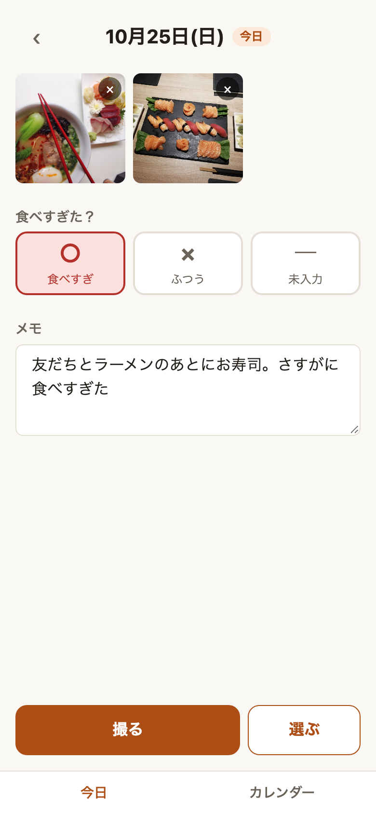
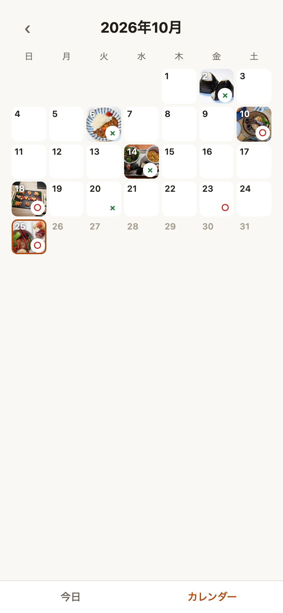

# journal-apps — 食事日記と釣果ノート

[](https://github.com/hiro603/journal-apps/actions/workflows/ci.yml)

写真とかんたんな記録を日付ごとに残し、月のカレンダーで振り返るスマホ向けの日記アプリを、共通の土台（`packages/journal/`）の上に2つ作りました。
どちらも記録は端末内（IndexedDB）にだけ保存し、サーバーには送りません。ホーム画面に追加してアプリのように使えます（PWA）。

| アプリ | 内容 | デモ |
|---|---|---|
| 食事日記（`apps/meal/`） | 食べたものを写真で残し、その日に「食べすぎたか」を ○ / × で付ける。1日1件 | https://meal-diary-sable.vercel.app |
| 釣果ノート（`apps/fishing/`） | 釣行ごとに釣果・釣り場・天気・潮・風・仕掛けを記録する。1日に複数件 | FISHING_DEMO_URL |

スマホで開き、ホーム画面に追加して使うのがおすすめです。

## 食事日記

<p>
  
  
</p>

### 主な機能

- **今日の記録**: 写真の追加（カメラで撮る / アルバムから複数選ぶ）と削除、食べすぎ ○ / × / 未入力の切り替え、ひとことメモ（自動保存）
- **カレンダー**: 月ごとに、各日の1枚目の写真と ○× を表示。日付をタップすると、その日の記録を見る・直すことができる
- **画像の前処理**: 保存前に長辺1200pxの JPEG に縮小し、位置情報などの EXIF を取り除く
- **ホーム画面への追加**: アイコン・全画面表示に対応。iOS の Safari で開いたときは、ホーム画面への追加を案内する

## 釣果ノート

### 主な機能

- **その日の釣行一覧**: 1日に何回でも釣行を追加できる。一覧には開始時刻・釣り場・釣果の要約（「アジ 12・サバ 3」）と1枚目の写真を出す
- **釣行の記録**: 開始時刻（今日の釣行は追加した時刻を自動で入れる）、釣り場、魚種ごとの匹数と最大サイズ、天気、潮、風速・風向き、仕掛け、メモ、写真。入力は自動保存
- **入力の補完**: 釣り場・魚種・仕掛けは、過去に入れた値を最近使った順に候補として出す
- **カレンダー**: 各日の1枚目の写真と、その日の合計匹数を表示。釣行はあったが0匹の日は「0」を薄く出す

## 技術スタック

| 分類 | 使用技術 |
|---|---|
| フレームワーク | Next.js 16（App Router）、React 19、TypeScript |
| スタイル | SCSS（CSS Modules）、デザイントークン（primitive / semantic の2層） |
| データ保存 | IndexedDB（Dexie.js 4、dexie-react-hooks） |
| テスト | Vitest、fake-indexeddb、Playwright（画面と画像処理の検証） |
| ホスティング | Vercel |

## 設計で工夫したこと

### 記録の保存・表示を、ほかのアプリに流用できる形にした

汎用的な部分（`packages/journal/`）とアプリに固有の部分（`apps/meal/`、`apps/fishing/`）を分け、1つのリポジトリで複数のアプリを管理する構成（npm workspaces）にしています。釣果ノートは、この土台の上に後から作りました。

- 記録は `Entry<TFields>` 型で表し、アプリ固有の項目は型引数で渡します。食事日記では `{ overate: boolean | null }`、釣果ノートでは釣り場・天気・潮・風・仕掛けと、魚種ごとの釣果の配列です
- カレンダーの部品は「食べすぎ」も「匹数」も知りません。アプリ側が `getBadge` 関数で、その日の記録の一覧から印（○× や合計匹数）を作って渡します。1日1件の食事日記も、1日に複数件の釣果ノートも同じ部品で表示できます
- 画面が依存するのは `JournalRepository` インターフェースだけです。将来クラウド保存（Supabase）に移るときは、その実装を差し替えるだけで済みます

### 入力の保存

保存ボタンは置かず、入力が止まって0.5秒たったら保存します（`useDebouncedSave`）。画面を離れるときと、アプリが裏に回ったとき（`visibilitychange`）は待たずに保存するので、入力の途中でアプリを閉じても消えません。釣果ノートの匹数・サイズ・風速は、入力中は文字列のまま持ち、保存するときに数値に直します。数値で持つと、「23.」のような入力の途中の値が「23」に戻ってしまうためです。

### データ設計

- 写真は記録とは別のテーブルに分けました。記録1件ごとに、表示用（長辺1200px）とサムネイル（長辺240px）の2つの画像を持ちます。カレンダーには1か月分の写真が並ぶため、軽いサムネイルだけを読み込みます
- ID は UUID、日時は `createdAt` / `updatedAt` で持ちます。将来クラウドと同期するときに、ID が衝突せず、どちらが新しいかを比べられます
- 「未入力」は `undefined` ではなく `null` で表します。値が入っていない状態と、項目そのものがない状態を区別するためです

### 画像処理とプライバシー

撮った写真は `createImageBitmap` で読み込み、canvas に描き直してから JPEG で保存します。描き直した画素だけが残るので、位置情報などの EXIF は一緒に保存されません。回転情報は描画の前に反映されるため、向きもずれません。この挙動は、位置情報と回転情報を埋め込んだ画像を使って実際のブラウザで確かめています。

### 日付の扱い

日付は `"YYYY-MM-DD"` のローカル日付で扱います。`toISOString()` は UTC で計算するため、日本時間の朝9時より前に記録すると前日の日付になってしまいます。これを避けるためです。「今日」はサーバー（UTC・ビルド時刻）では決めず、端末側で `useSyncExternalStore` を使って求めます。

### iOS Safari への対応

| 起きた問題 | 対応 |
|---|---|
| メモを入力してキーボードを閉じると、画面が押し上げられたまま戻らない | `body` に `overflow: hidden` を付けて内側だけスクロールさせる作りをやめ、ページ全体をスクロールさせる。タブバーと操作バーは `sticky` で画面下に固定する |
| 16px 未満の入力欄にフォーカスすると、画面が拡大される | 入力欄の文字は 16px 以上にする |
| `capture` 属性を付けると、アルバムから選べなくなる | 「撮る」（`capture` あり）と「選ぶ」（`capture` なし）でボタンを分ける |
| Safari とホーム画面のアプリで、データが別々に保存される | Safari で開いたときにホーム画面への追加を案内し、記録を始める場所をアプリに揃える |
| 7日間使わないとデータが消えることがある | ホーム画面に追加すると、この削除の対象外になる。あわせて `navigator.storage.persist()` を呼ぶ |

### アクセシビリティ

- 文字色はすべて WCAG AA のコントラスト比 4.5:1 を満たすように、トークンの値を決めました
- ○ / × の切り替えにはネイティブのラジオボタンを使い、キーボード操作と読み上げに対応しています
- ボタン・タブ・矢印など押せる部分は 44px 以上にしています。カレンダーの日付マスだけは、7列で並べる都合上、画面幅に合わせて小さくなります（320px 幅で約38px）
- 釣果ノートの天気・潮もネイティブのラジオボタンです。未入力に戻す「―」は、読み上げでは「未入力」と読みます
- カレンダーの各日には「10月3日(土) 食べすぎ 写真あり」「10月12日(月) 合計120匹」のような読み上げ用のラベルを付けています

## ディレクトリ構成

```
packages/journal/        # 汎用層：型、Repository、Dexie の実装、フック、部品（カレンダー・写真・メモ・タブバーなど）、日付・画像処理
apps/meal/src/
├─ app/                  # ルーティング（今日 / 日付指定 / カレンダー）、manifest
├─ meal/                 # 食事日記に固有の部分：項目の型、○× の切り替え、画面
└─ styles/tokens/        # デザイントークン（primitive / semantic）。オレンジ系
apps/fishing/src/
├─ app/                  # ルーティング（今日 / 日付指定 / 釣行 / カレンダー）、manifest
├─ fishing/              # 釣果ノートに固有の部分：項目の型、入力値の変換、並べ替え・集計、画面
└─ styles/tokens/        # デザイントークン。青系
```

共通の部品は semantic トークン（CSS 変数）だけを参照しています。2つのアプリは同じ変数名で値だけを変えているので、同じ部品のまま見た目が変わります。

## 開発

```bash
npm install                                  # リポジトリ直下で実行（全ワークスペースが入る）
npm run dev:meal                             # http://localhost:3000
npm run dev:fishing                          # http://localhost:3001
npm run dev:lan --workspace=apps/meal        # 同じ Wi-Fi のスマホから http://<MacのIP>:3000 で開く（釣果ノートは apps/fishing、3001）
npm test                                     # Vitest（日付計算・Repository・画像の寸法計算・釣果の入力変換と集計）
npm run typecheck                            # 各ワークスペースの型チェック
npm run build
```

LAN の http から開いた場合、HTTPS でしか使えない API（`storage.persist()` など）は動きません。ホーム画面への追加もうまく確認できません。これらの確認は、デプロイした後に本番の URL で行ってください。

## スクリーンショットの写真について

スクリーンショットの料理写真には、Wikimedia Commons で CC0（パブリックドメイン）として公開されている画像を使い、実際にアプリへ読み込ませて撮影しました。

- [Bowl of Ramen (Unsplash 1RyWImEc7K4)](https://commons.wikimedia.org/wiki/File:Bowl_of_Ramen_(Unsplash_1RyWImEc7K4).jpg)
- [Beef curry rice 003](https://commons.wikimedia.org/wiki/File:Beef_curry_rice_003.jpg)
- [Onigiri 001](https://commons.wikimedia.org/wiki/File:Onigiri_001.jpg)
- [Onigiri combo meal from Minneapolis, Minnesota](https://commons.wikimedia.org/wiki/File:Onigiri_combo_meal_from_Minneapolis,_Minnesota.jpg)
- [Bacon Pancakes - Moksha Caffè 2026-05-03](https://commons.wikimedia.org/wiki/File:Bacon_Pancakes_-_Moksha_Caff%C3%A8_2026-05-03.jpg)
- [Sushi Plate in Organic Sushi Prague 4](https://commons.wikimedia.org/wiki/File:Sushi_Plate_in_Organic_Sushi_Prague_4.jpg)

## 今後

- クラウド保存（Supabase）とログイン：Safari とホーム画面アプリでデータが分かれる問題と、機種変更でデータを移せない問題を、根本から解決する
